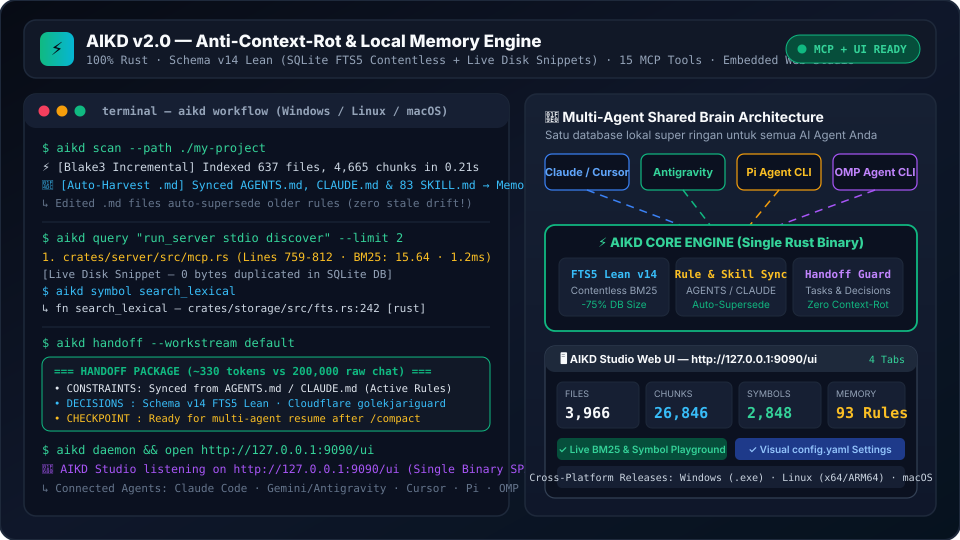

<div align="center">

# ⚡ AIKD — Stop AI Context Rot & Code Amnesia

### The Ultra-Fast Local Memory, Code Search & Anti-Context-Rot Engine for Every AI Agent

[](https://github.com/gelutjari/aikd/releases)
[](https://github.com/gelutjari/aikd/actions)
[](LICENSE)
[](https://www.rust-lang.org)
[](#-cross-platform-installation)

**One tiny ~10 MB Rust binary that gives Claude Code, Antigravity, Gemini CLI, Codex CLI, OpenCode, Cursor, Windsurf, Pi & OMP a shared, indestructible brain.**

*Zero cloud dependency. Zero Tantivy/Python bloat. Sub-millisecond BM25 search + Live Disk Snippets + Auto-Synced Rules (`AGENTS.md` / `CLAUDE.md` / `SKILL.md`) + Built-in Web Studio.*

[Why AIKD?](#-why-aikd-solving-the-10-biggest-ai-agent-pain-points) • [Code Motion](#-see-it-in-action-code-motion) • [30s Quick Start](#-30-second-quick-start) • [Supported Agents](#-works-with-16-cli--ide-agents) • [AIKD Studio UI](#-aikd-studio--built-in-web-dashboard) • [🇮🇩 Bahasa Indonesia](README.id.md)

</div>

---

## 🎬 See It In Action (Code Motion)

<div align="center">
  
</div>

---

## 🤔 Why AIKD? (Solving the #1 Complaints About AI Coding Agents)

Every developer using **Claude Code, Gemini CLI, ChatGPT/Codex, Cursor, Windsurf, OpenCode, or Pi/OMP** hits the exact same walls:

| Pain Point | What Happens Without AIKD | How AIKD v2.0 Fixes It |
| :--- | :--- | :--- |
| 😵 **Context Rot & Amnesia** | After 30–50 messages or `/compact`, the AI forgets your architecture rules and breaks working code. | **`aikd handoff`** re-anchors active constraints, decisions, tasks, and checkpoints in ~300–1,000 tokens — outside the chat window. |
| 💸 **Token Burn (`read_file` Spam)** | Agents `cat` entire 2,000-line files repeatedly just to locate one function. | **SQLite FTS5 Contentless (`chunks_fts`) + `symbol` lookup** returns exact line ranges & bounded live disk snippets in **~1–2ms**. |
| 🧩 **Multi-Agent Split-Brain** | Switching from Antigravity/Claude to Codex, OpenCode, Pi, or OMP forces you to re-explain everything from scratch. | **SQLite WAL Shared Brain** (`~/.aikd/aikd.db`) lets every CLI and IDE agent read & write the exact same memory concurrently. |
| 📜 **Stale Rules (`AGENTS.md` Drift)** | You update `AGENTS.md`, `CLAUDE.md`, or a `SKILL.md`, but the agent keeps following outdated rules. | **Auto-Harvest & Auto-Supersede** tracks Blake3 file hashes on every scan and automatically retires (`superseded`) old rules when `.md` files change. |
| 🐘 **Heavy Vector/Python Bloat** | Python RAG tools hog 2GB+ RAM, Docker containers, or duplicate gigabytes of chunk text. | **Schema v14 Lean Mode** stores tokens only (zero text duplication in DB) with a **single ~10 MB static Rust binary**. |

---

## ⚡ 30-Second Quick Start

### 1. Install (One Command — No Python, No Node, No Docker)

**Windows (PowerShell):**
```powershell
irm https://raw.githubusercontent.com/gelutjari/aikd/main/install.ps1 | iex
```

**Linux / macOS (Bash / Zsh):**
```bash
curl -sSf https://raw.githubusercontent.com/gelutjari/aikd/main/install.sh | bash
```

<details>
<summary><b>🔧 Or Build From Source / Cargo</b></summary>

```bash
git clone https://github.com/gelutjari/aikd.git
cd aikd
cargo build --release --bin aikd
# Binary is at target/release/aikd (or aikd.exe on Windows)
```
</details>

### 2. Initialize, Auto-Connect All Your AI Agents & Launch Studio
```bash
cd your-project
aikd init          # Generates smart config & scans project
aikd register      # Auto-registers AIKD MCP across ALL installed CLI & IDE agents!
aikd scan          # Blake3 incremental scan + syncs AGENTS.md / CLAUDE.md / SKILL.md
aikd daemon        # Starts REST API + AIKD Studio at http://127.0.0.1:9090/ui
```

That's it! Restart your AI agents and ask them:
> *"Check `aikd` `handoff` for active rules and tasks, then use `aikd` `query` / `symbol` before editing."*

---

## 🤖 Works With 16+ CLI & IDE Agents Out-of-the-Box

Run **`aikd register`** (or click **"Auto-Register"** in **AIKD Studio**) to automatically wire up `aikd serve` across all installed tools on your machine:

| Category | Supported AI Agents | Config Auto-Detection Path |
| :--- | :--- | :--- |
| **CLI Agents** | **Claude Code**, **Gemini CLI**, **OpenAI Codex CLI**, **OpenCode CLI**, **Pi Agent CLI**, **OMP Agent CLI**, **Qwen Code CLI**, **Hermes Agent CLI**, **MiMoCode** | `~/.claude.json`, `~/.gemini/settings.json`, `~/.codex/config.toml`, `~/.config/opencode/opencode.json`, `~/.pi/agent/mcp.json`, `~/.qwen/settings.json`, `~/.hermes/config.yaml`, `~/.mcp.json` |
| **IDEs & Desktop Apps** | **Antigravity IDE & CLI**, **Claude Desktop**, **Cursor**, **Windsurf**, **Cline (VSCode)**, **Continue**, **Qoder** | `~/.gemini/antigravity/mcp_config.json`, `claude_desktop_config.json`, `~/.cursor/mcp.json`, `~/.windsurf/mcp.json`, `~/.cline/mcp.json`, `~/.continue/config.json`, `~/.qoder/mcp.json` |

> **Built-in Protocol Compatibility:** `aikd serve` speaks standard MCP (`initialize` `2024-11-05`) **and** gracefully handles pre-handshake discovery probes like `server/discover` (used by OMP v19.1+), so **multiple CLI and GUI agents can share the same knowledge base simultaneously**.

---

## 🖥️ AIKD Studio — Built-In Web Dashboard (`/ui`)

Start the daemon (`aikd daemon`) and open **[http://127.0.0.1:9090/ui](http://127.0.0.1:9090/ui)** — a modern, zero-dependency SPA embedded directly inside the Rust binary:

1. **📊 Overview & Quick Scan:** Live database metrics, 1-click **On-Demand Directed Scan**, **Garbage Collect (GC)**, **Rebuild FTS5**, **Sync Rules & Skills (`.md`)**, Interactive **SVG File Dependency Graph**, and **Multi-Agent Event Coverage**.
2. **🔍 Live Search & Symbol Playground:** Test BM25 full-text queries and function/struct/class symbol lookups with sub-10ms latency, extension/path filters, and live syntax snippets read directly from disk.
3. **🧠 Structured Memory & Handoff Generator:** Browse, filter, create, or retire (`stale` / `archive`) `decision`, `constraint`, `fact`, `task`, `checkpoint`, and `discovery` entries, plus **1-click Copy Handoff** for instant context recovery.
4. **⚙️ Settings, Smart Agent Noise Presets & Connected Agents:**
   - Manage `scan.include_paths` visually without touching YAML by hand.
   - **3 Smart Multi-Agent Exclusion Presets** (`✨ Recommended`, `🎯 Strict Code & Rules Only`, `💬 Include Agent Sessions`) that automatically strip `.system_generated`, `scratch`, `.codex/.tmp`, browser profiles, telemetry, `node_modules`, `target`, and secrets (`auth.json`, `.env`).
   - **Connected AI Agents Matrix** with 1-click **Auto-Register** for every agent detected on your system.

---

## 🛠️ 15 Native MCP Tools (`aikd serve`)

| Tool | Purpose |
| :--- | :--- |
| `scan` | Incremental Blake3 file discovery, chunking, symbol extraction & `.md` rule sync |
| `query` | Ranked BM25 SQLite FTS5 search (+ optional hybrid vector search) with live disk snippets |
| `symbol` | Exact & prefix lookup for functions, structs, classes, interfaces with file + line ranges |
| `handoff` | Assembles anti-context-rot resume package (tasks, checkpoint, decisions, synced rules, events) |
| `memory_save` | Save typed durable memory (`fact`, `decision`, `constraint`, `discovery`, `task`, `checkpoint`) |
| `memory_list` | Inspect active or superseded memory items by kind & workstream |
| `memory_task` | Fetch active tasks & latest checkpoint after `/compact` or agent switch |
| `memory_lifecycle` | Mark outdated memory `stale` or `archive` without losing audit provenance |
| `memory_conflict` | Flag contradictory assertions across agents so neither silently overwrites truth |
| `event_append` | Append idempotent agent lifecycle events (`tool_call`, `file_change`, `checkpoint`, etc.) |
| `remember` / `recall` | Store and search raw session conversation history |
| `embed` | Optional vector embedding generation (`--features semantic` or `semantic-ext`) |
| `stats` / `status` | Index footprint, DB schema version, CPU/RAM profile, and health status |

---

## 🏗️ Lean Schema v14 Architecture

```
  ┌─────────────────────────────────────────────────────────────────────┐
  │  Claude Code · Antigravity · Gemini CLI · Codex · OpenCode · Pi/OMP │
  └──────────────┬───────────────────────────────────────┬──────────────┘
                 │ MCP (stdio JSON-RPC)                  │ HTTP / Browser
                 ▼                                       ▼
  ┌─────────────────────────────┐         ┌─────────────────────────────┐
  │       aikd serve (MCP)      │         │   aikd daemon (Axum REST)   │
  │  • 15 Built-in MCP Tools    │         │  • /ui  (AIKD Studio SPA)   │
  │  • Pre-init server/discover │         │  • /api/* (Query/Config/GC) │
  └──────────────┬──────────────┘         └──────────────┬──────────────┘
                 └───────────────────┬───────────────────┘
                                     ▼
  ┌─────────────────────────────────────────────────────────────────────┐
  │               Shared Rust Core (WAL SQLite — aikd.db)               │
  ├─────────────────────┬──────────────────────┬────────────────────────┤
  │ FTS5 Contentless    │ Auto Rule/Skill Sync │ Structured Memory      │
  │ (chunks_fts)        │ (AGENTS/CLAUDE/SKILL)│ & Event Journal        │
  │ + Live Disk Snippet │ + Blake3 Auto-       │ (decision, constraint, │
  │   (120 lines/16KB)  │   Supersede          │  task, checkpoint)     │
  └─────────────────────┴──────────────────────┴────────────────────────┘
```

- **Zero-Downtime Windows Self-Update Shim:** Installs versioned binaries under `~/.aikd/versions/<ver>/` and atomically flips a tiny shim at `~/.local/bin/aikd.exe` — never fails with `os error 5 (Access Denied)` even while MCP servers are running!
- **Cross-Platform Ready:** Official CI & Release workflows build binaries for **Windows (`x86_64`)**, **Linux (`x86_64`, `aarch64`)**, and **macOS (`x86_64`, `aarch64`)**.

---

## ⚙️ Recommended `AGENTS.md` / `CLAUDE.md` Snippet

Drop these 4 lines into your project's `AGENTS.md` or `CLAUDE.md` so every AI agent automatically uses AIKD:

```markdown
## AIKD Memory & Anti-Context-Rot Protocol
- Call `aikd` `handoff` or `memory_list` when starting complex tasks or resuming after `/compact`.
- Prefer `aikd` `query` and `aikd` `symbol` over blind full-file reads to save tokens.
- Save major architectural decisions, bug fixes, and server configs via `aikd` `memory_save`.
```

---

## 📄 License & Community

- **License:** MIT — see [LICENSE](LICENSE)
- **Repository:** [github.com/gelutjari/aikd](https://github.com/gelutjari/aikd)
- **Issues & Feature Requests:** [GitHub Issues](https://github.com/gelutjari/aikd/issues)
